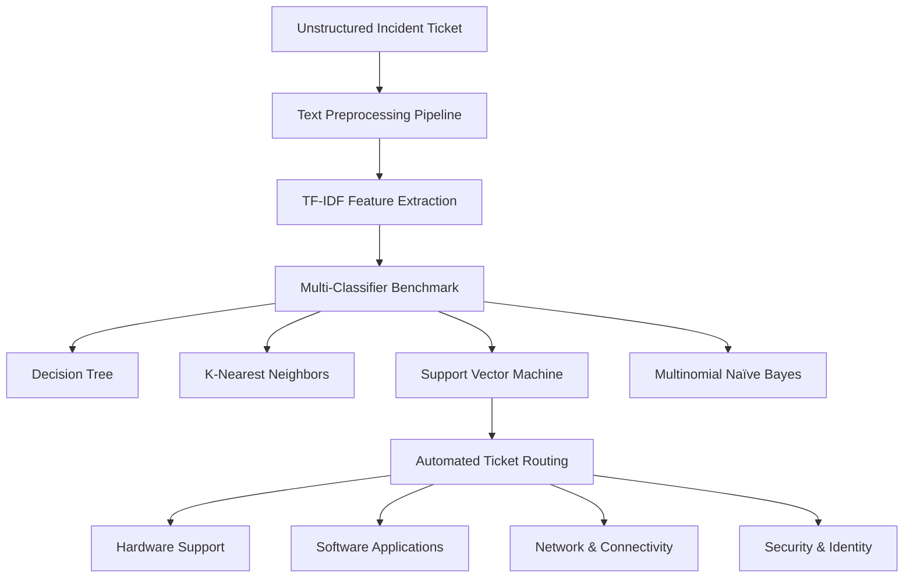

# Information-Ritriva

# IT Support Ticket Classifier
### Multi-Class Text Classification & Model Benchmark

[](https://www.python.org/)
[](https://scikit-learn.org/)
[](LICENSE)

An end-to-end natural language processing (NLP) pipeline designed to automatically categorize IT support and infrastructure incident tickets into functional operational categories. The project evaluates four classic machine learning algorithms across standardized classification metrics to establish an optimal triage and routing baseline.

---

## 📌 Problem Overview

In enterprise IT operations, service desks receive high volumes of unstructured user tickets daily. Manual triage creates bottlenecks, introduces routing errors, and increases Mean Time to Resolution (MTTR).

This system automates ticket categorization into four primary operational domains:



### Target Classes

| Category | Description | Representative Issues |
| :--- | :--- | :--- |
| **`Hardware`** | Physical equipment and peripheral defects | Screen flickering, battery drain, fan noise, RAM errors, broken charging pins, loose ports |
| **`Software`** | OS, software runtime, and application failures | App crashes, Excel freezes, update failures, dependency conflicts, license errors |
| **`Network`** | Connectivity, routing, and throughput issues | WiFi disconnects, VPN timeouts, slow bandwidth, DNS resolution failures, high latency |
| **`Security`** | Identity, authentication, and threat events | Phishing emails, 2FA prompt failures, account lockouts, malware detection, SSL warnings |

---

## 📊 Dataset Specifications

The dataset (`dataset.csv`) contains **100 curated, real-world IT service desk incident descriptions**, distributed uniformly across all four target classes:

| Class Label | Sample Count | Class Ratio | Status |
| :--- | :---: | :---: | :---: |
| `Hardware` | 25 | 25% | Balanced |
| `Software` | 25 | 25% | Balanced |
| `Network` | 25 | 25% | Balanced |
| `Security` | 25 | 25% | Balanced |
| **Total** | **100** | **100%** | **Uniform Distribution** |

> **Design Choice**: The uniform 1:1:1:1 distribution prevents class imbalance bias, ensuring that evaluation metrics (macro precision, recall, and F1-score) reflect true algorithmic performance rather than majority-class skew.

---

## ⚙️ Data Preprocessing & Feature Engineering

### 1. NLP Pipeline
Each raw text record undergoes a systematic four-stage cleaning process:
1. **Case Folding:** Converts all tokens to lowercase to ensure casing consistency.
2. **Tokenization & Sanitization:** Filters out punctuation, symbols, and numerical noise, retaining alphabetic tokens of length $\ge 2$.
3. **Stop-Word Removal:** Strips common functional English stop words that add minimal discriminative value.
4. **Morphological Stemming:** Normalizes inflected word endings (`-ing`, `-ed`, `-es`, `-s`) back to root tokens.

#### Sample Transformation

| Stage | Text Representation |
| :--- | :--- |
| **Raw Input** | `Laptop screen turns black randomly and flickers when moved. The LCD display cable or backlight seems physically damaged.` |
| **Cleaned Tokens** | `laptop screen turn black randomly flicker mov lcd display cable backlight seem physically damag` |

---

### 2. Numerical Vectorization (TF-IDF)
Cleaned text is transformed into high-dimensional numerical feature vectors using **Term Frequency–Inverse Document Frequency (TF-IDF)**:

- **Term Frequency ($TF$):** Relative occurrence of term $t$ in ticket $d$:
  $$TF(t, d) = \frac{f_{t,d}}{\sum_{t' \in d} f_{t',d}}$$

- **Inverse Document Frequency ($IDF$):** Penalizes ubiquitous terms while amplifying rare, category-defining terms:
  $$IDF(t) = \ln\left(\frac{1 + N}{1 + DF(t)}\right) + 1$$
  *Where $N = 80$ (training split) and $DF(t)$ is the document frequency of term $t$.*

- **Final Weight Formulation:**
  $$W(t, d) = TF(t, d) \times IDF(t)$$

The vectorizer extracts **619 distinct feature dimensions** from the training vocabulary.

---

## 🔬 Experimental Evaluation & Model Benchmark

### Evaluation Setup
- **Train/Test Split:** 80% Training (80 tickets) / 20% Testing (20 tickets)
- **Validation Strategy:** Stratified splitting with fixed `random_state=42` for exact reproducibility
- **Metrics Tracked:** Accuracy, Macro Precision, Macro Recall, Macro F1-Score, and Training Latency

### Comparative Benchmark Results

| Model | Accuracy | Precision (Macro) | Recall (Macro) | F1-Score (Macro) | Train Latency (ms) |
| :--- | :---: | :---: | :---: | :---: | :---: |
| **🥇 Support Vector Machine (Linear)** | **80.0%** | **0.816** | **0.800** | **0.797** | 7.40 ms |
| **🥈 Multinomial Naïve Bayes** | **80.0%** | **0.816** | **0.800** | **0.797** | **5.03 ms** |
| **🥉 K-Nearest Neighbors ($k=3$)** | 55.0% | 0.560 | 0.550 | 0.542 | **1.67 ms** |
| **❌ Decision Tree (CART)** | 45.0% | 0.479 | 0.450 | 0.447 | 8.12 ms |

---

### Detailed Classification Report (Linear SVM)

```
              precision    recall  f1-score   support

    Hardware       0.75      0.60      0.67         5
     Network       1.00      0.80      0.89         5
    Security       0.71      1.00      0.83         5
    Software       0.80      0.80      0.80         5

    accuracy                           0.80        20
   macro avg       0.82      0.80      0.80        20
weighted avg       0.82      0.80      0.80        20
```

---

### Benchmark Visualizations

#### 1. Confusion Matrix Comparison (All 4 Models)


#### 2. Accuracy & Macro F1-Score Comparison


---

## 📈 Hyperparameter & Representation Analysis

### 1. Neighborhood Sensitivity in KNN ($k \in [1, 9]$)
The number of neighbors $k$ directly impacts boundary smoothing in sparse TF-IDF feature space:

| $k$ Value | Accuracy (%) | Structural Behavior |
| :---: | :---: | :--- |
| **$k = 1$** | 65.0% | High variance; sensitive to nearest neighbor outliers. |
| **$k = 3$** | 55.0% | Boundary oscillation caused by tie-breaking on sparse word overlaps. |
| **$k = 5$** | 70.0% | Moderated neighborhood voting begins to filter word-level noise. |
| **$k = 7$** | 80.0% | Broader neighborhood stabilizes class consensus. |
| **$k = 9$** | **85.0%** | **Peak KNN Performance**: Sufficient smoothing across sparse high-dimensional vectors. |


---

### 2. Feature Representation Shift: Unigram vs. Bigram
We evaluated the impact of expanding the TF-IDF representation from unigrams $(1, 1)$ to combined unigram + bigram $(1, 2)$ tokens:

| Representation | Feature Space Dimension | SVM Accuracy (%) | Dimensional Impact |
| :--- | :---: | :---: | :--- |
| **Unigram $(1, 1)$** | **619** | **80.0%** | Compact, dense feature representations; high keyword concentration. |
| **Unigram + Bigram $(1, 2)$** | **1,602** | **80.0%** | 2.5x dimensional expansion without additional accuracy gain due to sparsity. |

**Insight:** On concise incident descriptions, unigrams efficiently capture core discriminative terms (`screen`, `vpn`, `phishing`, `crash`). Incorporating n-grams substantially increases matrix dimensionality and sparsity without offering distinct discriminative advantages.

---

## 💡 Technical Takeaways & Deployment Recommendations

1. **Production Recommendation — Linear SVM:**  
   Linear SVM establishes the strongest decision boundary. High-dimensional text spaces (619+ features) are predominantly linearly separable, allowing the maximum-margin hyperplane to generalize effectively without overfitting.

2. **Low-Latency Edge Alternative — Multinomial Naïve Bayes:**  
   Achieving identical 80.0% accuracy with the lowest computational footprint, Naïve Bayes represents an ideal solution for resource-constrained or high-throughput streaming environments where microsecond inference latency is critical.

3. **Models to Avoid:**  
   - **Decision Trees (45.0%):** Axis-aligned orthogonal splits struggle to model complex combinations of sparse lexical features, leading to high variance and overfitting on training keywords.
   - **Low-$k$ KNN (55.0%):** Euclidean distance calculations degrade in high dimensions due to distance concentration, causing nearest-neighbor searches to become noisy.

---

## 📁 Repository Structure

```
.
├── dataset.csv            # 100 labeled IT support incidents across 4 categories
├── text_classification.py # Complete pipeline (cleaning, vectorization, models, plots)
├── confusion_matrix.png   # Generated 4-model confusion matrix heatmaps
├── model_comparison.png   # Performance comparison bar chart
├── what_if_knn.png        # Line plot of KNN accuracy vs k value
├── requirements.txt       # Dependencies
└── README.md              # Project documentation
```

---

## 🚀 Quickstart Guide

### 1. Clone the Repository
```bash
git clone https://github.com/<your-username>/it-support-ticket-classifier.git
cd it-support-ticket-classifier
```

### 2. Install Dependencies
```bash
pip install -r requirements.txt
```

### 3. Run the Pipeline
Execute the complete classification workflow:
```bash
python text_classification.py
```

The script will process the dataset, train and evaluate all four models, output benchmark metrics to the terminal, and update all visual plots.

---

## 📄 License

This project is licensed under the [MIT License](LICENSE).
